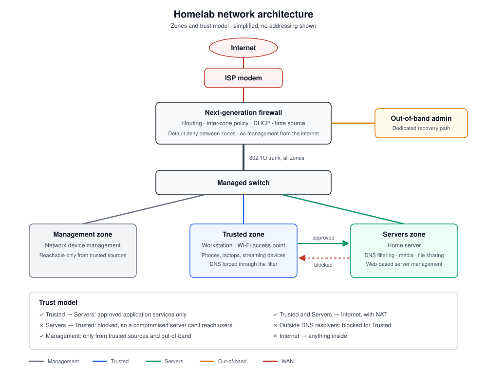

# Homelab Network Documentation

This repository documents the design, configuration, and maintenance of my homelab and home network environment.
It demonstrates my ability to manage enterprise-style infrastructure using open-source and professional tools.

---

## Overview

### Primary Goals
- Implement segmented network architecture for LAN, Guest, IoT, and Lab use
- Deploy network-wide DNS-level filtering for security and privacy
- Integrate NAS and server-hosting systems into the network
- Document configuration changes using Git-based workflows
- Lay groundwork for secure remote access and monitoring

---

### Technologies Used
- Fortinet FortiGate (FortiOS): routing, firewall policies, DHCP, NTP
- TP-Link managed switch (802.1Q VLANs)
- Pi-hole DNS
- Samba (SMB)
- Jellyfin
- Cockpit
- UFW Firewall
- DHCP, NAT/PAT, VLAN concepts
- Linux (Debian / Raspberry Pi OS)
- Windows and macOS clients

---

## Network Services

### DNS Filtering (Pi-hole)
- Deployed Pi-hole as the primary DNS resolver for the LAN
- Configured ~250,000 blocklist rules
- Achieved approximately 32% DNS query blocking
- Reduced ads, trackers, and malicious domains across all devices
- Integrated with DHCP and static IP assignments

---

## Related Projects

This homelab network supports and integrates with the following standalone infrastructure projects:

- **Raspberry Pi NAS & Media Server**  
  Centralized storage and media streaming platform built on Linux, providing SMB file sharing and Jellyfin-based media access across the LAN.  
  https://github.com/swimmyOS/rpi-nas-media-server

---

## Current Network (Segmented, October 2026)

The original flat network has been replaced by a segmented design. A next-generation firewall routes separate zones for management, trusted devices and servers over a single 802.1Q trunk, the Wi-Fi router now runs as an access point, and the home server sits in its own zone. Pi-hole filters DNS for every trusted device, and the firewall blocks attempts to use any other resolver.

- **[Architecture](docs/architecture.md):** components, zones, trust model, DNS and time design
- **[Design decisions](docs/design-decisions.md):** the main choices and the alternatives considered
- **[Project summary](docs/project-summary.md):** how the migration was planned, validated and hardened, and lessons learned

Detailed configuration, addressing and operational runbooks are kept in private documentation.

---

## Lessons Learned
- DNS filtering and DHCP integration
- Linux service and storage management
- Firewall hardening and least-privilege access
- Cross-platform troubleshooting (Windows, macOS, smart devices)
- Professional documentation and version control using Git

---

## Future Plans
- Deploy monitoring (Grafana + InfluxDB)
- Add IDS/IPS (Suricata or Snort)
- Containerize network services
- Implement VPN-based remote access

---

## Author

**Joseph Leahy Jr.**  
IT & Cybersecurity Enthusiast | Help Desk Tier 1  
https://www.linkedin.com/in/joseph-l-904673159
